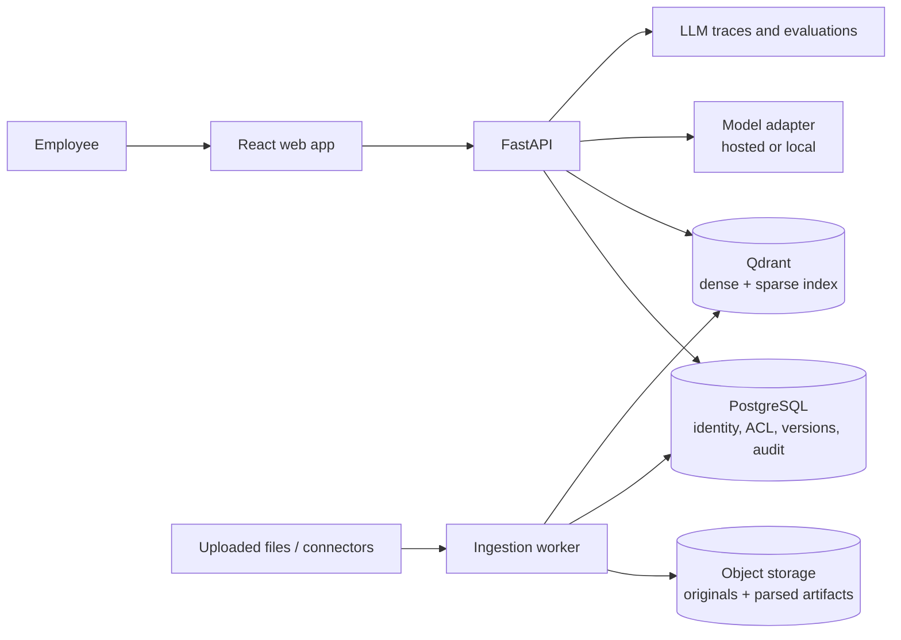

# Initial architecture

## Trust boundaries

- PostgreSQL is the source of truth for identity, organization membership, document versions, and permissions.
- Every retrieval request is scoped to the authenticated organization and authorized document set before evidence is used to generate an answer.
- Search-index permission payloads are a retrieval filter, not the only authorization boundary. API and persistence checks must enforce the same scope.
- Reusable organization group names are exact values from verified OIDC group claims. Workspace admins manage the group catalog, existing ACL values are backfilled, and uploader claims are synchronized on first document upload; document policies may only be assigned to registered groups through the API, and retrieval rechecks the caller's current claim values.
- Answer history records the question, answer, exact cited text, source-version and chunk identifiers, generation and reranker model names, and retrieval/prompt versions. It is user-scoped and retention-controlled; it contains sensitive text and is separate from body-free HTTP request logs.
- Answer history also records whether a request searched the latest indexed versions alone or expanded to older versions for temporal intent.
- Uploaded files and URLs are untrusted input. Parsing runs asynchronously with resource limits; remote URL ingestion must validate destinations and block private-network access.

## Request path

1. Authenticate the caller and resolve organization, groups, and document grants.
2. Resolve the caller's document access in PostgreSQL and restrict the Qdrant search to those documents and the latest indexed versions by default. Questions that clearly signal a historical comparison also retrieve a bounded candidate set from older indexed versions.
3. Retrieve dense and sparse candidates with organization and group filters applied in Qdrant. The history path applies the same filters and only runs for temporal/version-comparison intent.
4. For explicit relationship questions, take up to four seed documents from the strongest authorized passages, follow at most eight curated same-organization links whose targets remain in the caller's allowed-document set, and search those targets separately. Fuse latest/historical candidates with RRF and rerank each bounded candidate pool. The API records whether the answer used latest-only, historical, relationship, or combined scope.
5. Generate a citation-grounded answer or abstain when no indexed passages are retrieved or the model fails to cite verifiable evidence. Curated relationship labels guide navigation but are not treated as factual evidence. The model may return potential conflict findings, each linked to at least two retrieved chunks; the API validates those chunk references and persists findings with answer history. The answer owner can confirm/dismiss a finding; the API rechecks source access and records the disposition in the audit stream. Findings are model suggestions and require human review.
6. Verify that each citation maps to a retrieved passage, compact citation numbers, and return only passages explicitly cited by the answer.
7. Return the answer and persist the user-scoped provenance record with only its cited passages when answer history is enabled.

## Version update path

1. Fetch or receive a source update and compare its stable source ID and content hash.
2. Store the new original and parsed representation as a new version.
3. Add deterministic version-addressed chunks without deleting prior-version points.
4. After successful indexing, update the Qdrant `is_latest` payload and report processing status.
5. Preserve the version used by old answers and expose a text diff. New versions become latest only after indexing succeeds; explicit temporal questions can search older indexed versions. Cross-document links are workspace-admin curated, audited, and only used as navigation metadata for explicitly relationship-focused searches.

## Source deletion path

1. Require a workspace-admin role and lock the document row so new version uploads or reprocessing cannot start concurrently.
2. Reject deletion while any version is queued, parsing, or indexing.
3. Remove all Qdrant points for the document and its complete local version directory. If either cleanup step fails, retain the database record so an admin can retry.
4. Delete answer-history rows that contain cited excerpts from the source, retain a body-free audit event with aggregate counts, then cascade-delete document/version metadata.

The source deletion endpoint is idempotent for already removed vector points and files, so a retry can finish after a partial external-store cleanup. Database commit failures after file/index deletion leave a metadata record that can be retried; the stored content is already gone.
