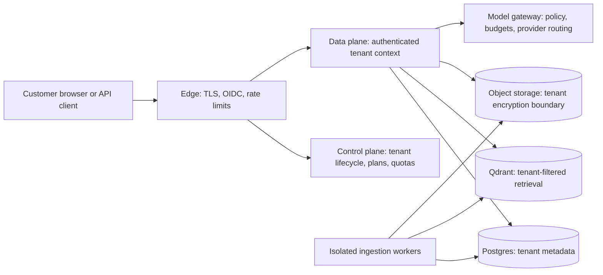

# Managed-service path

The first release remains one organization per self-hosted installation. Organization IDs are already stored on source records and included in vector payloads. That is a migration seam, not proof that the current API is safe for multiple organizations in one process.

## Target shape

## Migration gates

1. **Finish and pilot the single-organization release.** Prove ingestion, citations, version switching, group permissions, restore, and quality on one approved customer corpus.
2. **Make tenant identity unforgeable.** Resolve tenant IDs only from verified identity/API-key records. Never accept an organization ID from a request body or a client-controlled header. Carry an immutable tenant context through API, workers, audit events, traces, and model jobs.
3. **Prove storage isolation.** Keep tenant predicates in relational queries and vector filters; add database row-level security or separate schemas/databases as an independent guard. For higher-assurance plans, support per-tenant Qdrant collections/clusters and per-tenant encryption keys. Object keys must be tenant-prefixed and access must be policy-checked, not inferred from the prefix.
4. **Isolate asynchronous work.** Queue messages contain tenant and source-version IDs, workers re-authorize the source before processing, and retries/dead letters retain tenant context without copying document content into logs.
5. **Add the control plane.** Provision/suspend/delete tenants, users, identity connections, quotas, model policy, retention, and billing records. Control-plane credentials cannot query customer document data.
6. **Add usage and operating controls.** Meter stored bytes, parsed pages, embedding tokens, model input/output tokens, requests, and worker time. Enforce quotas before expensive work and document how customers export or delete all data.
7. **Independently verify boundaries.** Run cross-tenant negative tests against every API path, direct database access, vector retrieval, async jobs, caches, traces, backups, and deletion workflows before serving a second tenant in the same deployment.

## Isolation progression

Start a hosted pilot with a dedicated stack per customer. It is operationally heavier but lets the team validate provisioning, upgrades, support, and deletion without making shared-index isolation the first risk. Move to shared infrastructure only after tenant-context propagation and cross-tenant verification are automated. Keep a dedicated deployment option for customers with stricter isolation or data-residency needs.

## Product and commercial boundary

Open-source Sourcebound remains installable and useful without the hosted control plane. A future managed service can charge for operations customers otherwise run themselves: hosted upgrades, backup/restore, monitoring, identity integration support, managed connectors, higher availability, and capacity. Do not make the self-hosted release depend on a proprietary service to ingest, retrieve, or export its data.

## Unresolved decisions

- Dedicated tenant stack versus shared Postgres/Qdrant as default hosted tier.
- Tenant key custody and customer-managed encryption key support.
- Region placement, residency, retention, and deletion verification.
- Model provider allow-list, data-processing terms, and self-hosted-model capacity.
- Service-level objectives, incident response, support tiers, and usage units.
